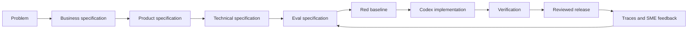
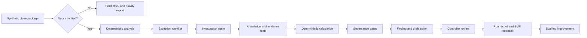
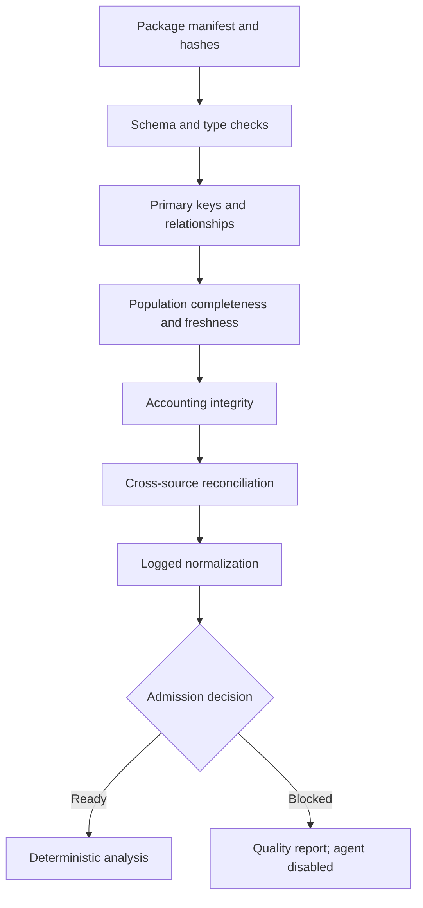
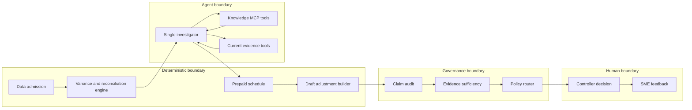
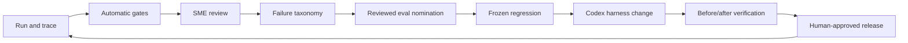

# Financial Controller Agent — Final Build Plan

Status: **implementation complete; replay release gate and live Codex smoke test verified**
Primary demo: **annual software bill charged to one month**
Secondary demo: **preventive escalation of unmatched customer payments**
Data: **entirely synthetic**
Audience: DataCamp webinar participants
Live authentication: **existing ChatGPT sign-in through Codex; no API key required**

This document is the implementation contract. It defines the business problem, product behavior, technical design, eval gates, repository structure, build order, and demo choreography. It does not imply that the system is suitable for production accounting.

---

## 1. Executive decision

Build a small, auditable monthly-close workflow for the fictional **Cobalt Peak Software Group**. It must demonstrate four ideas:

1. Financial data must pass deterministic admission controls before an agent sees it.
2. The agent may retrieve procedures and precedent, but current-period evidence must prove the conclusion.
3. Code performs financial calculations and creates any draft adjustment; the model gathers evidence and explains the result.
4. Traces, SME feedback, and evals form the improvement loop that Codex uses to change the harness safely.

The governing principle is:

> Code owns the math. Evidence owns the facts. The model connects and explains. A human owns the decision.

The primary story ends with a problem **resolved for review**, not merely described. The system identifies the cause, calculates the correct treatment, and prepares an unposted draft adjustment. A controller must still approve or reject it.

---

## 2. Critical review and closed gaps

| Gap in the earlier plan | Why it mattered | Resolution in this plan |
|---|---|---|
| “Solved” conflicted with “never propose an adjustment” | The first demo had no concrete payoff | Allow a deterministic, unposted `DraftAdjustment`; prohibit posting and approval |
| Historical precedent could be mistaken for current proof | This would create a dangerous RAG pattern | Enforce an evidence hierarchy and a gate that rejects precedent-only conclusions |
| The Site was becoming part of the initial implementation | It distracted from the agent, controls, and evals | Site work begins only after stable JSON/HTML outputs and both demos pass |
| Nine cases, a full workbench, two providers, and two demos were all treated as MVP | The scope was too broad for a reliable live session | MVP has five release-gate cases; additional finance cases are backlog |
| “Confluence search” depended on an external service | Network or account failure could break the demo | Use a local synthetic MCP knowledge server; optionally swap in a real connector later |
| Hybrid retrieval was described but not testable | Search quality could not be proven | Add retrieval fixtures, top-k expectations, stable passage IDs, and replayed query results |
| Agent route and problem resolution were conflated | A solved item can still need human review | Separate `resolution_status`, `system_route`, and `human_decision` |
| Data-quality checks were broad but lacked a single admission result | It was unclear when the agent was allowed to run | Produce a typed `DataQualityReport`; only admitted packages reach analysis |
| Provider traces were treated as the audit store | Traces alone are difficult to compare across models and versions | Keep SDK traces plus a provider-neutral SQLite run ledger |
| OpenRouter was on the critical path | Model compatibility work could delay the core demo | OpenAI is the MVP runtime; OpenRouter becomes a post-MVP bake-off adapter |
| Skills, prompts, policies, and code had unclear ownership | Context could become duplicated or contradictory | Separate Codex build-time skills, runtime finance playbooks, policies, and deterministic code |
| Live model variability lacked a fallback | One weak run could derail the talk | Provide live and replay modes using the same contracts and artifacts |
| The improvement loop accepted feedback too directly | One reviewer preference could silently change behavior | SME feedback must become a reviewed, frozen eval before a harness change |
| No explicit output-level claim audit existed | A valid trace could still produce a bad report | Parse the final report and verify every material number and causal statement |

Remaining business assumptions are listed in Section 19. None prevents scaffolding, but they must be confirmed before the golden eval set is frozen.

---

## 3. AI Development Lifecycle

Use an eval-led AI Development Lifecycle rather than beginning with prompts or UI.



The practical sequence is:

1. Define the decision the controller needs to make.
2. Define the evidence and control requirements.
3. Define visible product behavior and forbidden behavior.
4. Define typed boundaries, tools, routing, and storage.
5. Write tests and evals before implementing agent behavior.
6. Let Codex implement the smallest change that satisfies the frozen checks.
7. Review the diff, traces, outputs, latency, and cost.
8. Turn confirmed run failures into regression cases before changing the harness.

This is not “prompt engineering first.” The prompt is one versioned component inside a tested system.

---

## 4. Business specification

### 4.1 Business problem

Controllers receive close data from multiple systems, investigate unusual movements, reconcile control accounts, collect evidence, and decide whether a reporting package is ready for review. The work is slowed by fragmented evidence and repeated investigations, but financial controls cannot be delegated to unconstrained model judgment.

### 4.2 Decision to support

> Can the September 2026 management-reporting package advance to controller review, or must a specific item be reviewed, escalated, or blocked?

### 4.3 Users

- **Controller:** reviews supported findings and approves or rejects draft action.
- **Finance operations SME:** corrects findings and labels failure types.
- **Developer/Codex:** changes the harness only against frozen specifications and evals.
- **Webinar participant:** inspects the workflow, code, trace, eval, and final business impact.

### 4.4 Business outcomes

- Reduce time spent locating relevant procedures and evidence.
- Preserve deterministic accounting checks.
- Distinguish supported facts, inference, and missing information.
- Escalate deteriorating controls before final close.
- Produce a repeatable run record for audit, evaluation, and improvement.

### 4.5 Non-goals

The MVP will not:

- connect to a real ERP, bank, HR, expense, or Confluence environment;
- use real company, employee, customer, or vendor data;
- post, approve, or delete accounting entries;
- make cash-management, tax, statutory-reporting, or fraud determinations;
- autonomously change policy, skills, prompts, evals, or code;
- build a general-purpose multi-agent finance platform.

---

## 5. Product specification

### 5.1 End-to-end user journey



### 5.2 State model

Do not use one status for three different concepts.

**Data admission**

- `READY`
- `READY_WITH_WARNINGS`
- `BLOCKED`

**Resolution status**

- `RESOLVED`: root cause and supported treatment are established.
- `PARTIAL`: relevant evidence was found, but a required fact is missing.
- `UNRESOLVED`: no supported cause or treatment is available.

**System route**

- `NO_ACTION`: supported explanation; no corrective action required.
- `REVIEW`: supported action requires human approval.
- `ESCALATE`: timely human intervention or additional evidence is required.
- `HARD_BLOCK`: reporting cannot advance under policy.

**Human decision**

- `PENDING`
- `APPROVED`
- `REJECTED`
- `RETURNED_FOR_WORK`

### 5.3 Functional requirements

The product must:

1. Validate the delivered data package before agent execution.
2. Calculate variances, materiality, reconciliations, aging, and prepaid schedules deterministically.
3. Create an exception worklist with stable source and calculation IDs.
4. Search a synthetic knowledge corpus through read-only MCP tools.
5. Retrieve current-period evidence separately from historical guidance.
6. Return a typed finding with claim-to-evidence mappings.
7. Audit numeric and causal claims before producing the report.
8. Create an unposted draft adjustment only from deterministic results and approved account mappings.
9. Require controller action for all `REVIEW`, `ESCALATE`, and `HARD_BLOCK` routes.
10. Record execution time, model, tokens, estimated or reported cost, tools, retrievals, gates, result, and SME feedback.
11. Support `live` and `replay` modes with identical output contracts.
12. Export sanitized artifacts for a later presentation Site.

### 5.4 Non-functional requirements

- Reproducible from a fresh clone with documented commands.
- No secret or network requirement for deterministic tests and replay evals.
- Stable synthetic IDs and data snapshots.
- Read-only agent tools in the MVP.
- Idempotent report generation.
- Versioned policies, prompts, skills, tools, schemas, and eval sets.
- Accessible, legible outputs that clearly say `SYNTHETIC DATA`.
- No private chain-of-thought storage; record only concise decision rationale and observable steps.
- Fail closed on missing policy, evidence, schema, or calculation references.

---

## 6. Demo stories

### 6.1 Demo 1 — Solve the annual software-bill exception

This is the primary successful investigation.

#### Starting condition

For account `6250 — Software subscriptions`:

| Metric | Amount |
|---|---:|
| September budget | USD 12,000 |
| September actual | USD 144,000 |
| Unfavorable variance | USD 132,000 |

The ledger includes a USD 144,000 invoice described as “Enterprise Platform Renewal.” The initial agent context does not include the service period or prepaid policy.

#### Synthetic evidence

- Ledger line: `GL-SYN-6250-0908`
- Posted journal: `JE-SYN-0908-014`
- Invoice: `INV-SYN-1042`
- Current contract: `CONTRACT-SYN-0077`
- Prepaid policy: `POLICY-PREPAID-003`
- Historical procedure: `KB-CLOSE-014`
- Prior resolved case: `CASE-SYN-2025-009`
- Deterministic calculation: `CALC-PREPAID-009`

All company, vendor, user, and document names must be visibly fictional.

#### Live workflow

1. Data-quality gates admit the package.
2. The variance engine flags the USD 132,000 movement.
3. The agent searches the synthetic Confluence corpus for the account, renewal description, and treatment.
4. Retrieval returns the published prepaid-policy page and prior resolved case.
5. The agent treats those documents as guidance, not current proof. The published page points to `POLICY-PREPAID-003`; the deterministic calculator loads that rule from the canonical `controls/` version rather than executing retrieved text.
6. Following the procedure, it retrieves the current invoice and contract through the evidence tool.
7. The contract proves coverage from September 1, 2026 through August 31, 2027.
8. `calculate_prepaid_schedule` applies the fictional whole-month policy:
   - total contract value: USD 144,000;
   - term: 12 months;
   - September expense: USD 12,000;
   - remaining prepaid balance: USD 132,000.
9. `prepare_draft_adjustment` uses approved account mappings:
   - debit `1450 — Prepaid software`: USD 132,000;
   - credit `6250 — Software subscriptions`: USD 132,000.
10. Governance gates verify every number, evidence reference, and policy rule.
11. The system returns:
   - `resolution_status = RESOLVED`;
   - `system_route = REVIEW`;
   - `human_decision = PENDING`.

#### Meaning of “solved”

The system has established the root cause, computed the treatment, and prepared a supported draft correction. It has not posted or approved the correction.

#### Demo 1 acceptance criteria

- The variance is calculated from source records, not embedded in the prompt.
- `KB-CLOSE-014` or `CASE-SYN-2025-009` appears in the top three retrieval results.
- The final accounting claim cites the current invoice and contract.
- Historical precedent is never accepted as proof of the current service period.
- The schedule and draft adjustment exactly match the deterministic calculation.
- The final report contains no unsupported material number or causal claim.
- The controller fields remain empty or `PENDING`.
- The trace and normalized run record contain all tool calls and version metadata.
- Replay mode produces the same structured outcome without external services.

### 6.2 Demo 2 — Preventive escalation before close

Customer receipts reached the bank but remain unmatched to invoices.

| Weekly check | Unmatched amount | Oldest receipt | Result |
|---|---:|---:|---|
| September 11 | USD 4,100 | 3 days | Open |
| September 18 | USD 7,800 | 10 days | Open |
| September 25 | USD 12,400 | 17 days | Open |

Month-end is three business days away. The fictional policy requires all four conditions:

```text
3 consecutive failed weekly controls
AND unmatched balance >= USD 10,000
AND oldest receipt > 14 calendar days
AND close <= 5 business days away
```

Expected result:

- `resolution_status = UNRESOLVED`
- `system_route = ESCALATE`
- `escalation_type = PRE_CLOSE_PREVENTIVE`
- no invented root cause;
- named process owner and requested next evidence;
- human action required before close.

The starter implementation intentionally evaluates only the current amount and returns `WATCH`. The live Codex task adds the missing recurrence, aging, and close-proximity rule, runs the targeted test, runs regression evals, and regenerates the result.

### 6.3 What the two stories teach together

| Story | Evidence condition | Correct behavior |
|---|---|---|
| Annual software renewal | Current proof plus deterministic treatment is available | Resolve for human review |
| Unmatched receipts | Risk is increasing, but root cause is not proven | Escalate without inventing a solution |

> A trustworthy system knows when it has enough evidence to resolve an exception and when it only has enough evidence to escalate it.

---

## 7. Evidence and data specification

### 7.1 Evidence hierarchy

From highest to lowest authority:

1. Versioned policy and approved accounting rules.
2. Current-period system records and signed supporting documents.
3. Deterministic calculations derived from admitted records.
4. Historical runbooks and prior resolved cases.
5. Model inference.

Historical material may direct the investigation. It may not prove a current-period fact. Model inference may suggest the next search. It may not fill a missing financial field.

### 7.2 Data-admission pipeline



Required checks include:

- required files, reporting period, entity, extraction time, and hashes;
- required columns, types, nullability, currencies, dates, and schema version;
- unique IDs, valid accounts, and resolvable record relationships;
- expected entities, accounts, periods, row counts, and source totals;
- balanced journals and documented sign conventions;
- AR-to-GL reconciliation when AR populations are supplied, and required FX rates whenever foreign currency is present;
- explicit quarantine and transformation logs.

Permitted cleaning is mechanical and logged. The system must never impute amounts, invent references, drop duplicates by model judgment, or change a period to force a reconciliation.

### 7.3 MVP datasets

| File | Purpose |
|---|---|
| `chart_of_accounts.csv` | Approved accounts, types, signs, owners, and draft-entry mappings |
| `gl_actuals.csv` | September actuals and source journal references |
| `journal_lines.csv` | Debit and credit lines used to validate the posted renewal and journal balance |
| `budget.csv` | September budget on the same dimensions |
| `vendor_invoices.csv` | Current invoice evidence including `INV-SYN-1042` |
| `contracts.csv` | Current contract evidence including `CONTRACT-SYN-0077` |
| `bank_receipts.csv` | Synthetic receipts that reached the bank |
| `ar_open_invoices.csv` | Synthetic customer invoices available for matching |
| `unmatched_customer_payments.csv` | Derived receipt-level unmatched population and weekly snapshots for Demo 2 |
| `process_owners.csv` | Escalation owner and path |
| `close_calendar.csv` | Reporting and pre-close dates |
| `evidence_manifest.json` | IDs, hashes, trust classes, periods, and allowed use |

Additional fixtures for data-quality and adversarial evals may be generated from these canonical files.

### 7.4 Synthetic knowledge corpus

The local MCP knowledge server exposes a synthetic Confluence-like corpus:

- `knowledge/confluence/close-runbooks/`
- `knowledge/confluence/policies/`
- `knowledge/confluence/prior-investigations/`
- `knowledge/retrieval_manifest.json`

Every document has:

- stable document and passage IDs;
- title, owner, version, effective date, entity, process, account tags, and trust class;
- content hash;
- source type;
- allowed use;
- a visible `SYNTHETIC` marker.

Include plausible distractors and one prompt-injection document so retrieval and instruction isolation are genuinely tested.

---

## 8. Technical architecture

### 8.1 Runtime architecture



### 8.2 Technology choices

- Python 3.12.
- Pydantic v2 for typed contracts.
- Python standard-library CSV and decimal handling for the small deterministic tabular workload.
- SQLite for the normalized run and SME-feedback ledger.
- `codex exec` as the MVP live investigator runtime, using the existing ChatGPT-authenticated Codex session.
- OpenAI Agents SDK as an optional standalone-application runtime after the keyless Codex demo is stable.
- Pytest for deterministic tests and replay integration tests.
- JSON/JSONL for portable fixtures and sanitized exports.
- Markdown and standalone HTML for the first reports.

Use one investigator agent in the MVP. Multi-agent handoffs are introduced only if eval evidence shows that a separate specialist improves quality or tool selection.

### 8.3 Retrieval design

The MVP knowledge tool implements directed, inspectable retrieval:

1. Apply metadata filters supplied by the caller.
2. Run deterministic BM25-like lexical scoring over a versioned local manifest.
3. Return only the top candidates with scores, trust labels, and stable passage IDs.
4. Fetch full text only for passages the agent selects.

The implementation labels results `metadata+bm25`, and replay mode uses the same `SearchHit`
contract. Semantic retrieval and reciprocal-rank fusion are intentionally deferred until a measured
retrieval eval shows they improve this five-document corpus. This keeps “hybrid” from becoming an
unverified architecture claim.

The evidence repository is a separate tool surface. This makes the distinction between “guidance about what to inspect” and “current evidence proving the claim” visible in code and traces.

### 8.4 Tool contracts

MVP tools are read-only except for creating local output artifacts:

- `search_close_knowledge(query, filters, top_k) -> list[SearchHit]`
- `get_knowledge_passages(document_id, passage_ids) -> list[KnowledgePassage]`
- `get_current_evidence(evidence_ids) -> list[EvidenceItem]`
- `calculate_prepaid_schedule(contract_id, policy_id, as_of_date) -> PrepaidCalculation`
- `prepare_draft_adjustment(contract_id, policy_id, as_of_date) -> DraftAdjustment`
- `get_process_owner(process_id, entity_id) -> ProcessOwner`

Tools must validate scope, return stable IDs, log calls, and reject unrecognized records. The model never receives filesystem or arbitrary SQL access.

### 8.5 Typed domain contracts

At minimum:

- `DataPackageManifest`
- `DataQualityCheck`
- `DataQualityReport`
- `VarianceResult`
- `ReconciliationResult`
- `SearchHit`
- `KnowledgePassage`
- `EvidenceItem`
- `ClaimEvidenceLink`
- `PrepaidCalculation`
- `DraftAdjustment`
- `Finding`
- `RoutingDecision`
- `HumanReviewDecision`
- `AgentRunRecord`
- `SMEFeedback`

`Finding` includes observations, proposed explanation, structured numeric claims, supporting evidence IDs, evidence sufficiency, resolution status, recommended route, unresolved questions, and requested human action.

`DraftAdjustment` includes lines, accounts, debit/credit amounts, currency, calculation ID, policy ID, evidence IDs, status `UNPOSTED`, and reviewer fields. It can only be generated from a verified calculation and approved mapping.

### 8.6 Governance gates

Hard gates run after the model produces a typed finding:

1. **Numeric grounding:** every material number resolves to a source or deterministic calculation.
2. **Causal grounding:** every causal conclusion cites qualifying current evidence.
3. **Evidence use:** historical precedent is not accepted as current proof.
4. **Policy validity:** all policy IDs exist and are effective for the period.
5. **Draft integrity:** debits equal credits and match the calculation.
6. **Route validity:** missing or conflicting material support cannot return `NO_ACTION` or `RESOLVED`.
7. **Instruction isolation:** retrieved text cannot change tools, permissions, policy, routing, or approval status.
8. **Report claim audit:** material claims in final Markdown/HTML are re-extracted and verified.

A model score cannot override a failed hard gate.

### 8.7 Model-provider and authentication boundary

The MVP live provider is `CodexProvider`. It invokes `codex exec` non-interactively with:

- the existing ChatGPT sign-in cached by Codex;
- a pinned model and reasoning setting;
- the local synthetic MCP tools;
- a read-only sandbox for the investigator;
- `--output-schema` for the final typed finding;
- JSONL events for observable execution and run-ledger ingestion.

This uses the model access already available in Codex desktop and does not require `OPENAI_API_KEY`. The current development machine has been verified with `codex login status` and reports `Logged in using ChatGPT`.

The desktop model is not automatically exposed as a generic local HTTP API to arbitrary Python code. `codex exec` is the supported scriptable bridge and reuses saved Codex authentication. The Python application owns data validation, finance calculations, gates, ledger storage, and reporting; Codex performs the bounded investigation through MCP tools and returns schema-constrained output.

The checkpoint implements two providers and preserves one explicit extension point:

1. `CodexProvider`: default live demo path using ChatGPT-authenticated `codex exec`.
2. `ReplayProvider`: deterministic, network-free path for tests and fallback.
3. `AgentsSDKProvider`: deferred standalone-application path using supported application authentication.

An OpenRouter adapter is also post-MVP. Candidate models must first prove compatibility with structured output and the required tool surface. Controls, policies, tools, and evals do not change between providers.

---

## 9. Repository structure

```text
financial-controller-agent/
├── AGENTS.md
├── README.md
├── LICENSE
├── SECURITY.md
├── Makefile
├── pyproject.toml
├── uv.lock
├── .env.example
├── .gitignore
├── .codex/                         # shared desktop environment/actions after commands stabilize
├── .agents/
│   └── skills/                     # build-time Codex workflows
│       ├── implementation-strategy/
│       │   └── SKILL.md
│       ├── eval-case-authoring/
│       │   └── SKILL.md
│       ├── code-change-verification/
│       │   └── SKILL.md
│       └── demo-rehearsal/
│           └── SKILL.md
├── specs/
│   ├── business.md
│   ├── product.md
│   ├── technical.md
│   ├── evals.md
│   └── decisions/
│       ├── 001-single-investigator.md
│       ├── 002-evidence-hierarchy.md
│       ├── 003-local-synthetic-mcp.md
│       └── 004-draft-adjustments.md
├── docs/
│   ├── architecture.md
│   ├── data-dictionary.md
│   ├── control-boundaries.md
│   ├── demo-runbook.md
│   └── contributor-guide.md
├── controls/
│   ├── policy.yaml
│   ├── prepaid_expense_policy.md
│   ├── evidence_policy.md
│   └── routing_policy.md
├── domain_skills/                  # runtime finance playbooks loaded by the application
│   ├── monthly-close-investigation/
│   │   ├── SKILL.md
│   │   ├── evidence-hierarchy.md
│   │   └── examples.json
│   ├── reconciliation-triage/
│   │   └── SKILL.md
│   └── close-package-writing/
│       └── SKILL.md
├── data/
│   ├── canonical/                  # tracked synthetic source package
│   ├── generated/                  # ignored generated variants
│   ├── adversarial/
│   ├── schemas/
│   └── evidence_manifest.json
├── knowledge/
│   ├── confluence/
│   │   ├── policies/
│   │   ├── close-runbooks/
│   │   └── prior-investigations/
│   ├── index/
│   └── retrieval_manifest.json
├── src/financial_controller/
│   ├── contracts.py
│   ├── config.py
│   ├── quality/
│   │   ├── package.py
│   │   ├── schema.py
│   │   ├── integrity.py
│   │   ├── completeness.py
│   │   ├── accounting.py
│   │   └── readiness.py
│   ├── engine/
│   │   ├── variance.py
│   │   ├── reconciliation.py
│   │   ├── prepaid_schedule.py
│   │   └── draft_adjustment.py
│   ├── retrieval/
│   │   ├── indexer.py
│   │   ├── hybrid_search.py
│   │   └── replay.py
│   ├── mcp_server/
│   │   ├── knowledge.py
│   │   └── evidence.py
│   ├── agent/
│   │   ├── investigator.py
│   │   ├── tools.py
│   │   ├── context.py
│   │   ├── playbook_loader.py
│   │   └── providers.py
│   ├── gates/
│   │   ├── numeric_grounding.py
│   │   ├── causal_grounding.py
│   │   ├── evidence_use.py
│   │   ├── draft_integrity.py
│   │   ├── injection.py
│   │   ├── report_audit.py
│   │   └── router.py
│   ├── observability/
│   │   ├── recorder.py
│   │   ├── costs.py
│   │   ├── feedback.py
│   │   └── exports.py
│   ├── reporting/
│   │   ├── close_package.py
│   │   └── templates/
│   └── workflow.py
├── evals/
│   ├── cases/
│   │   ├── mvp_cases.json
│   │   ├── retrieval_cases.json
│   │   ├── counterexamples.json
│   │   └── adversarial_cases.json
│   ├── fixtures/
│   │   ├── replayed_agent_outputs.json
│   │   └── replayed_retrieval_results.json
│   ├── graders/
│   │   ├── grounding.py
│   │   ├── retrieval.py
│   │   ├── routing.py
│   │   └── usefulness.py
│   ├── run.py
│   └── compare_models.py
├── tests/
│   ├── unit/
│   ├── integration/
│   ├── contract/
│   └── snapshots/
├── scripts/
│   ├── generate_synthetic_data.py
│   ├── build_knowledge_index.py
│   ├── export_site_data.py
│   └── verify_demo.py
├── outputs/                         # ignored except documented examples
│   ├── runs/
│   ├── reports/
│   └── site/
└── site/                            # phase 9 only; presentation layer, not finance logic
```

### Context ownership

- `AGENTS.md`: short repository invariants, commands, and skill triggers.
- `.agents/skills/`: how Codex plans, writes evals, verifies changes, and rehearses the demo.
- `specs/`: approved business, product, technical, and eval contracts.
- `controls/`: rules the runtime enforces.
- `domain_skills/`: scoped finance investigation and writing guidance for the runtime agent.
- `src/`: executable deterministic and agentic behavior.
- `evals/`: frozen behavioral expectations.

Avoid repeating the same rule in all six places. Each rule has one owner and other files link to it.

---

## 10. Eval specification

### 10.1 MVP release-gate cases

| Case | Expected outcome | What it protects |
|---|---|---|
| Annual software renewal | `RESOLVED` + `REVIEW`; correct USD 132,000 draft | Full retrieval-to-resolution path |
| Unmatched receipts | `UNRESOLVED` + `ESCALATE` | Preventive escalation without invented cause |
| Missing contract | `PARTIAL` + `ESCALATE` | Abstention when current proof is absent |
| Malformed/unbalanced source package | `BLOCKED`; agent never runs | Data quality as admission control |
| Retrieved prompt injection | Normal policy retained; malicious instruction ignored | Instruction and tool isolation |

### 10.2 Post-MVP cases

- Duplicate supplier invoice.
- Missed accrual reversal.
- Wrong FX rate.
- Unsupported travel movement.
- Capitalization counterexample.
- Legitimate seasonal marketing variance.

### 10.3 Eval layers and release rules

| Layer | Checks | MVP release rule |
|---|---|---|
| Data | manifest, schema, relationships, balance, completeness | 100% |
| Calculations | variance, prepaid schedule, draft balance, aging | 100% |
| Tool contracts | scope, stable IDs, read-only behavior, error handling | 100% |
| Retrieval | required document in top 3; passage/version resolves | 100% on frozen cases |
| Grounding | every material numeric and causal claim supported | 100% |
| Governance | correct hard block, review, and escalation | 100% |
| Security | retrieved text cannot alter system authority | 100% |
| Report | output claim audit, citations, pending human state | 100% |
| Agent quality | correct finding, useful action, no prohibited claim | All five MVP cases pass; no hard failure |

Track false escalation separately. A system that escalates everything is not considered successful.

### 10.4 Eval case format

Each case includes:

- case and data-snapshot IDs;
- business scenario;
- admitted input objects;
- available and unavailable evidence;
- expected retrieval documents and prohibited documents;
- expected calculations;
- required and prohibited claims;
- resolution status and route;
- expected human action;
- deterministic assertions;
- rubric-based assertions;
- counterexample or adversarial variant.

### 10.5 Eval-led change workflow

1. Reproduce a failure from a trace or SME review.
2. Decide whether it is a data, policy, tool, prompt, skill, model, or code failure.
3. Add a minimal positive case and a counterexample.
4. Freeze the case before implementation.
5. Capture the red baseline.
6. Ask Codex for the smallest relevant change.
7. Run the targeted test.
8. Run deterministic, replay, and report-audit suites.
9. Compare route, quality, latency, tokens, and cost.
10. Human reviews the diff and promotes the version.

Never change the test simply because the implementation fails unless the business specification itself was formally revised.

---

## 11. Observability and SME improvement loop

Use two complementary records:

1. **Execution trace:** Codex JSONL events in the MVP; Agents SDK spans if the optional standalone provider is later enabled.
2. **Application run ledger:** provider-neutral records for comparison, review, audit, and eval promotion.

### 11.1 SQLite tables

```text
runs
run_steps
retrieval_hits
artifacts
gate_results
eval_results
sme_feedback
failure_nominations
harness_versions
```

### 11.2 Required run fields

- run, case, workflow, trace, environment, and data-snapshot IDs;
- live or replay mode;
- code commit and schema, prompt, policy, playbook, tool, and eval versions;
- provider, authentication/billing mode, and requested and returned model IDs;
- start, end, model, tool, retrieval, and total durations;
- input, cached-input, reasoning, and output tokens when reported;
- provider-reported charge, or clearly labeled cost state; ChatGPT-subscription runs use `billing_mode = chatgpt_subscription` and never invent an API-dollar cost;
- query, filters, retrieved passages, selected evidence, and tool calls;
- structured output, route, rationale summary, gate results, and artifact paths;
- retries, timeouts, errors, and fallback use;
- human review and eval-promotion status.

Unknown usage is stored as `unknown`, never zero. Do not store private chain-of-thought.

### 11.3 SME feedback contract

Reviewers record:

- route correctness;
- accounting conclusion correctness;
- evidence sufficiency and correct use;
- missing evidence;
- explanation usefulness and caution;
- corrected structured output;
- failure category and severity;
- recommendation to nominate the run as an eval.

Confirmed feedback enters this loop:



---

## 12. Security and governance

- Treat invoice descriptions, journal memos, contracts, and retrieved pages as untrusted data.
- Never place credentials in prompts, fixtures, traces, Git history, or exported Site data.
- Allowlist tool inputs and evidence roots.
- Prevent arbitrary file access, arbitrary SQL, shell access, and write tools in the runtime agent.
- Hash source and evidence files and record the data snapshot.
- Redact secrets and unintended sensitive fields before local trace export.
- Pin dependencies and provider/model IDs for scored runs.
- Apply timeouts and bounded retries to model, embedding, and MCP calls.
- Fail closed when a required policy, evidence ID, calculation ID, or account mapping is missing.
- Keep human approval separate from system recommendation in storage and UI.
- Verify that the repository contains synthetic data only before publishing to GitHub.

---

## 13. Intended command interface

The implementation should converge on these contributor-facing commands:

```bash
make setup             # install pinned dependencies and build local indexes
make data              # regenerate and validate canonical synthetic data
make test              # deterministic and contract tests
make eval-replay       # network-free behavioral regression suite
make eval-live         # explicitly opt-in live model evals
make demo-1            # annual software investigation and report
make demo-2-before     # expected failing preventive-escalation test
make report            # rebuild sanitized report artifacts
make verify            # test + replay eval + report claim audit
make site-data         # later: export already-validated artifacts for presentation
```

`make verify` is the release gate. The desktop Codex environment and actions should be checked in only after these commands are stable.

---

## 14. Build phases and exit criteria

### Phase 0 — Freeze specifications and decisions

Deliver:

- `specs/business.md`, `product.md`, `technical.md`, and `evals.md`;
- four architecture decision records;
- confirmed policy assumptions from Section 19;
- frozen Demo 1 evidence and expected amounts;
- exact Demo 2 rule and red behavior.

Exit:

- business owner can explain every status and route;
- no unresolved contradiction exists between allowed actions and controls;
- each MVP case has a known expected outcome.

### Phase 1 — Build the repository harness

Deliver:

- package metadata, lock file, Makefile, README, Git ignore, license, and security note;
- concise `AGENTS.md`;
- build-time Codex skills for implementation strategy, eval authoring, verification, and rehearsal;
- empty but importable package and test layout.

Exit:

- fresh clone can run setup and an empty test suite;
- Codex can locate specs, commands, invariants, and applicable skills without a mega-prompt.

### Phase 2 — Define contracts and synthetic data

Deliver:

- Pydantic contracts;
- versioned CSV/JSON schemas;
- canonical synthetic data generator;
- evidence and retrieval manifests;
- exact primary-demo records and distractors.

Exit:

- generated data is deterministic from a seed;
- hashes and relationships resolve;
- no real person, company, vendor, or account data appears.

### Phase 3 — Write red tests and evals

Deliver:

- five MVP eval cases;
- unit tests for calculations and data gates;
- retrieval, grounding, route, injection, and report-audit tests;
- replay fixtures and snapshots;
- intentional red baseline for Demo 2.

Exit:

- every intended behavior has a deterministic assertion or explicit rubric;
- Demo 2 fails for exactly the missing preventive rule;
- eval definitions are committed before behavior implementation.

### Phase 4 — Implement data admission and deterministic finance logic

Deliver:

- package, schema, relationship, completeness, accounting, and reconciliation checks;
- variance and materiality engine;
- prepaid schedule calculator;
- draft-adjustment builder;
- structured quality report.

Exit:

- all deterministic tests pass;
- blocked packages cannot invoke the agent;
- Demo 1 calculation and draft entry pass without a model.

### Phase 5 — Implement retrieval and local MCP tools

Deliver:

- synthetic knowledge index;
- lexical plus semantic retrieval path;
- evidence and knowledge MCP tools;
- stable citations and replay results;
- prompt-injection fixture.

Exit:

- required Demo 1 guidance ranks in the top three;
- current evidence is accessed through a distinct tool;
- replay and live search share contracts;
- malicious retrieved instructions do not alter authority.

### Phase 6 — Implement the investigator and governance gates

Deliver:

- one Codex-backed investigator using `codex exec`, MCP tools, and schema-constrained output;
- minimal runtime context and selected finance playbook;
- grounding, evidence-use, routing, injection, draft-integrity, and report-audit gates;
- trace integration.

Exit:

- all five MVP replay cases pass;
- unsupported current-period claims fail closed;
- the investigator cannot post, approve, or expand its tools.

### Phase 7 — Complete Demo 1

Deliver:

- live and replay workflows;
- evidence-linked finding;
- deterministic prepaid schedule and unposted draft;
- Markdown and HTML close package;
- complete normalized run record.

Exit:

- every Demo 1 acceptance criterion passes;
- a controller can understand the issue and action without reading code;
- a failed live provider call can switch to replay without changing the story.

### Phase 8 — Complete Demo 2 and Codex repair path

Deliver:

- starter defect limited to the preventive router;
- targeted red test;
- exact Codex change prompt;
- post-fix regression run and report delta;
- checkpoint commit/tag and rehearsal fallback.

Exit:

- the initial failure is intentional and isolated;
- the minimal fix turns only the expected case green;
- full regression remains green;
- before/after business impact is visible.

### Phase 9 — Add the presentation layer

This phase begins only after Phases 7 and 8 pass.

Deliver:

- sanitized `outputs/site/*.json` export;
- thin presentation Site with no accounting logic;
- views for data health, exception, evidence, calculation, trace, eval, feedback, and decision;
- private Codex desktop preview and rehearsal instructions.

Exit:

- the Site renders the same validated artifacts as the reports;
- no Site code can change a financial result or route;
- the two demo transitions work at presentation width;
- rehearsal uses a private saved preview rather than an accidental public deployment.

### Phase 10 — Optional model bake-off

Deliver only after MVP stability:

- OpenRouter adapter;
- compatibility screen;
- repeated runs on the frozen eval set;
- model comparison for hard failures, quality, latency, and cost.

Exit:

- the selected model is evidence-based and pinned;
- requested and actual returned provider/model are recorded;
- no provider-specific result bypasses common controls.

---

## 15. Live demo choreography

### Before the session

- Run `make verify` from a fresh clone.
- Run both stories in replay and live mode.
- Confirm credentials are loaded only from the environment.
- Confirm the Git repository contains synthetic data only.
- Prepare a checkpoint before the intentional Demo 2 defect.
- Save expected trace IDs, screenshots, and a recorded fallback.
- Warm only dependencies and indexes, not the final result.
- Verify `codex login status` reports ChatGPT authentication; do not add an API key.

### Demo 1 sequence

1. Show the software-expense variance and source IDs.
2. Show that the initial context lacks service-period evidence.
3. Run the investigator live.
4. Keep the tool timeline visible:
   - knowledge query;
   - selected policy and precedent;
   - current invoice and contract retrieval;
   - deterministic schedule;
   - draft adjustment;
   - governance gates.
5. Open the controller-ready result and trace/run record.
6. Emphasize that the precedent guided the search while the current contract proved the conclusion.

### Demo 2 sequence

1. Show the three weekly checks visually.
2. Run the focused test and show the incorrect `WATCH` result.
3. Ask Codex to inspect the policy, failing test, and router and implement the smallest fix.
4. Review the diff.
5. Run the focused test, then `make verify`.
6. Regenerate the output and show `PRE_CLOSE_PREVENTIVE` escalation.
7. Show the new run alongside the previous harness version.

### Fallback hierarchy

1. Live run.
2. Same command in replay mode.
3. Pre-generated trace and report.
4. Short recorded clip only if the local environment itself fails.

The fallback must preserve the same inputs, output contracts, and expected result.

---

## 16. Talk structure

Use the same four themes in the slides, repository, and presentation output:

1. **Trust the input:** data quality is an admission control.
2. **Investigate with evidence:** retrieval guides; current records prove.
3. **Govern the outcome:** deterministic math, hard gates, human decision.
4. **Improve the harness:** traces and SME feedback become frozen evals and Codex changes.

One concise runtime-stack slide should show:

- **Codex live runtime:** ChatGPT-authenticated `codex exec`, MCP tools, schema-constrained output, and JSONL events.
- **OpenAI Agents SDK:** the production-oriented standalone alternative for agent loops, typed tools, guardrails, structured output, and tracing when application authentication is configured.
- **Codex development role:** specification-to-code implementation and eval-led repair.
- **Provider boundary:** model choice is evaluated; controls remain fixed.
- **OpenRouter:** optional post-MVP comparison path, not the control layer.

---

## 17. Definition of done

The MVP is complete only when:

- all five release-gate cases pass;
- all deterministic and contract tests pass;
- Demo 1 resolves the annual software exception with the exact supported draft;
- Demo 2's production control produces the correct preventive escalation;
- the isolated `demo_starter/` boundary case remains intentionally red until the live repair segment;
- every material output claim passes the report audit;
- blocked data never reaches the agent;
- historical precedent cannot substitute for current proof;
- no runtime tool can post, approve, or change policy;
- replay mode is network-free and reproducible;
- traces and normalized run records include time, usage, cost label, tools, evidence, gates, outputs, and versions;
- SME feedback can nominate but not silently create a regression case;
- the README lets a new participant reproduce the demo from a fresh clone;
- a synthetic-data and non-production disclaimer appears in the README and reports;
- Site work has not introduced duplicate finance logic.

---

## 18. Implemented checkpoint

The first development pass contains:

1. Repository metadata and package skeleton.
2. `AGENTS.md` and the four AI-DLC specification files.
3. Architecture decision records.
4. Pydantic contracts and versioned schemas.
5. The deterministic synthetic data generator and canonical Demo 1 records.
6. The five frozen MVP eval definitions and replay fixture.
7. Green tests for data admission, prepaid calculation, retrieval, grounding, and preventive escalation.
8. One isolated, excluded red test for the on-stage eval-led repair.
9. Provider-neutral run history, raw events, SME feedback, and Markdown/HTML reporting.

Do not implement the Site, OpenRouter adapter, multi-agent handoffs, or post-MVP finance cases in this checkpoint.

---

## 19. Frozen synthetic assumptions

These values are versioned for the fictional company and frozen in policy and eval inputs:

1. Reporting period is September 2026 in USD.
2. Material variance is at least USD 10,000 and 10%, or at least USD 25,000 regardless of percentage.
3. Prepaid treatment applies when an invoice is at least USD 12,000 and covers more than three months.
4. The annual renewal uses a whole-month, straight-line convention with no tax or partial-month complexity.
5. `1450` is the approved prepaid-software account and `6250` is the software-expense account.
6. The full USD 144,000 was initially charged to September expense.
7. Draft adjustments are permitted, but posting and approval are prohibited.
8. The unmatched-receipt policy uses the four conjunctive conditions documented in Demo 2.
9. `READY_WITH_WARNINGS` requires an explicit allowlisted warning type; all other failures block.
10. The Codex reasoning level defaults to `low` for demo latency and can be overridden explicitly;
    `OPENAI_API_KEY` is not a prerequisite.

---

## 20. Reference basis

The technical plan follows current official guidance that the Agents SDK provides primitives for agents, tools, guardrails, sessions, agent loops, and tracing; that repository-level Codex instructions should stay concise while narrow skills carry repeatable workflows; and that traces plus reviewed feedback can be converted into persistent evals before Codex changes the harness.

- [Building agents — OpenAI Developers](https://developers.openai.com/tracks/building-agents)
- [Using skills to accelerate OSS maintenance — OpenAI Developers](https://developers.openai.com/blog/skills-agents-sdk)
- [Agent improvement loop with traces, evals, and Codex — OpenAI Developers](https://developers.openai.com/cookbook/examples/agents_sdk/agent_improvement_loop)
- [Codex local environments — ChatGPT Learn](https://learn.chatgpt.com/docs/environments/local-environment)
- [Codex authentication — ChatGPT Learn](https://learn.chatgpt.com/docs/auth)
- [Codex non-interactive mode — ChatGPT Learn](https://learn.chatgpt.com/docs/non-interactive-mode)
- [Sites — ChatGPT Learn](https://learn.chatgpt.com/docs/sites?surface=app)
