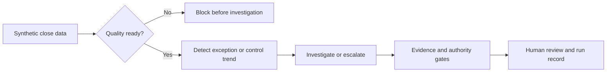

# Financial Controller Agentic Workflow

An eval-led, auditable monthly-close demonstration built for a DataCamp session. Every company,
person, vendor, customer, document, and amount is synthetic.

> Deterministic code owns the math. Evidence owns the facts. The model connects and explains. A human owns the
> decision.

## What the demo shows

1. Deterministic data-quality admission before any model call.
2. A material annual-software expense investigated through synthetic Confluence-style knowledge.
3. Current invoice and contract evidence used to calculate a USD 132,000 prepaid reclassification.
4. An unposted draft adjustment routed to a controller for review.
5. A second control that escalates recurring unmatched receipts before month-end.
6. Traces, evals, SME feedback, timing, token usage, and versioned run records.



The [process design](docs/process-design.md) traces both cases, their source records, and the
decision at each stage.

## Quick start

Requirements: Python 3.11+, `uv`, Git, and the Codex CLI signed in with ChatGPT for live mode.

```bash
make setup
make verify
make demo-1
```

In a separate terminal, run `make site` to serve the read-only review experience at
[http://127.0.0.1:4173/](http://127.0.0.1:4173/).
Open that address in Codex desktop's browser. It shows package admission, both finance cases,
saved runs, tool calls, governance gates, and SME feedback. The site uses only local synthetic
data and does not start an agent, approve a draft, or post an entry. It works without an API key;
new runs appear after a refresh. Do not open `src/financial_controller/site/static/index.html`
directly: that is only the HTML shell and cannot load the local finance API without `make site`.

No API key is required for the default live path. `make demo-1` invokes `codex exec`, which reuses
the local Codex ChatGPT sign-in. Confirm it with:

```bash
codex login status
```

All tests and replay evals are network-free after setup:

```bash
make test
make eval-replay
```

`uv.lock` is included. Use `uv sync --extra dev --frozen` when you want the exact tested
environment after cloning.

## Demo stories

### 1. Annual software renewal

September software expense is USD 144,000 against a USD 12,000 budget. The investigator searches
synthetic close guidance, then retrieves the current invoice and contract to prove a twelve-month
service period. Deterministic code calculates USD 12,000 current expense and USD 132,000 prepaid,
and prepares an unposted draft adjustment for controller review.

### 2. Preventive escalation

Unmatched customer receipts grow across three weekly checks to USD 12,400; the oldest item reaches
17 days and close is three business days away. A deterministic rule escalates before the control
becomes a final-close failure without inventing a root cause.

## Repository map

- `specs/`: business, product, technical, and eval contracts.
- `controls/`: executable policy inputs and evidence rules.
- `data/canonical/`: generated synthetic finance records.
- `knowledge/`: synthetic runbooks and prior investigations.
- `domain_skills/`: finance SME playbooks; direct live-agent loading is planned.
- `src/financial_controller/`: validation, finance engine, retrieval, agent, gates, reporting.
- `src/financial_controller/site/`: local, read-only visual review of source data and saved runs.
- `evals/`: frozen behavioral cases and replay fixtures.
- `.agents/skills/`: repo-local Codex development workflows.

Start with [how we built it](docs/ai-dlc/README.md), the [build plan](docs/ai-dlc/build-plan.md),
and the [visual process design](docs/process-design.md). For implementation details, see
[architecture](docs/architecture.md); for commands, see [how to run the demo](docs/run-the-demo.md).
The [visualization plan](docs/visualization-plan.md) describes the current local screen and its
remaining provenance improvements.

## Safety boundary

This project is educational and not production accounting software. It does not connect to a real
ERP or bank, post entries, approve a close, or use real financial data.
