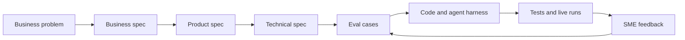

# How we built the financial controller agent

This repository follows an AI development lifecycle: start with a controller's decision, specify
the evidence and controls, turn them into evals, build the smallest working system, then use runs
and finance SME feedback to improve it. The model is one part of that system.

| Stage | Question we answer | Where to look |
|---|---|---|
| Problem and business spec | What must the controller decide, and what would count as useful support? | [Business spec](../../specs/business.md) |
| Product spec | What should the reviewer see? What states and actions are allowed? | [Product spec](../../specs/product.md) |
| Technical spec | Which layer owns data, math, retrieval, explanation, and approval? | [Technical spec](../../specs/technical.md), [architecture](../architecture.md) |
| Eval spec | Which good and bad outcomes must the system distinguish? | [Eval spec](../../specs/evals.md), [five cases](../../evals/cases.yaml) |
| Implementation | What did we build, and what is still missing? | [Build plan](build-plan.md) |
| Run and feedback | What happened, how long did it take, and what should change? | `outputs/runs/`, `outputs/run_ledger.sqlite3`, `financial-controller feedback` |

## The context is designed, not dumped into one prompt

The [synthetic data package](../../data/canonical/) provides current-period records. The
[canonical policy](../../controls/policy.yaml) defines thresholds and account mappings. The
[knowledge corpus](../../knowledge/confluence/) contains procedures and prior investigations that
can guide a search, but cannot prove a current-period fact. The [MCP server](../../src/financial_controller/mcp_server/server.py)
exposes bounded tools to the live investigator. [Pydantic contracts](../../src/financial_controller/contracts.py)
and [governance gates](../../src/financial_controller/gates/audit.py) constrain the result.

The `.agents/skills/` directory contains **Codex development workflows**: implementation
strategy, eval authoring, verification, and demo rehearsal. `domain_skills/` contains **finance SME
playbooks**. The live investigator currently uses a bounded procedure embedded in
`CodexProvider._prompt`; loading a versioned domain playbook directly is a tracked next step in the
[build plan](build-plan.md). We should not describe that integration as already done.

## A change enters through an eval

Suppose an SME finds a run that treats a prior-year case as proof of this year's contract dates.
The reviewer records the failed run and missing evidence. We add a frozen case requiring the
current contract, reproduce the failure, change the harness, and run `make verify`. The feedback
does not silently rewrite the policy or approve an adjustment.

For the business process itself, start with the [visual process design](../process-design.md).
