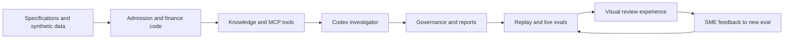

# Build plan

This is the working plan for the synthetic financial controller agent. It separates what runs
today from the next changes. The [process design](../process-design.md) shows the runtime path;
[how we built it](README.md) shows the AI development lifecycle.

## The decision we support

For the fictional Cobalt Peak Software Group's September 2026 close, can a material exception move
to controller review, or does it need more evidence or immediate escalation? The demo uses two
cases: an annual software bill charged to one month and customer receipts that remain unmatched as
close approaches. No record in this repository represents a real company or person.

The operating rule is simple: code calculates, current evidence proves, the model investigates and
explains, and a human decides. The system can prepare an **unposted** draft adjustment. It cannot
post or approve one.

## What exists now

| Block | Current implementation | What to show |
|---|---|---|
| Synthetic source package | Eleven generated CSV tables plus package and evidence manifests | `data/canonical/`, `data/evidence_manifest.json` |
| Admission | File, required-column, row count, hash, relationship, journal balance, period, and selected reconciliation checks | `financial-controller validate` |
| Finance logic | Variance, prepaid schedule, draft entry, and preventive receipt rule in Python | `src/financial_controller/engine/` |
| Knowledge lookup | Five local synthetic documents, metadata filters, lexical ranking, stable passage IDs | `knowledge/`, `retrieval_manifest.json` |
| Investigator | `codex exec` using the saved ChatGPT login and scoped local MCP tools; replay fixture for offline runs | `src/financial_controller/agent/` |
| Decision gates | Evidence IDs, numeric claims, current proof, human authority, draft balance, and unsafe guidance | `src/financial_controller/gates/` |
| Run history | SQLite ledger, JSONL events, finding JSON, Markdown and basic HTML reports, SME feedback command | `outputs/` after a run |
| Local visual review | Read-only site for admission, both cases, saved traces, gates, telemetry, and SME feedback | `make site` and [visual review](../visualization-plan.md) |
| Release gate | Normal tests and five replay eval cases; a separate intentional red test for live repair | `make verify`, `make demo-red` |

The last verified live investigation succeeded through the saved Codex login in about 29 seconds.
That is one rehearsal observation, not a latency guarantee. Subscription usage reports token counts
but not a provider dollar cost, so the ledger leaves cost empty.

## Build sequence and exit criteria

1. **Define the decision and examples — done.** The business, product, technical, and eval specs
   describe the two cases and the required human boundary. The five release cases are frozen in
   `evals/cases.yaml`.
2. **Make bad data visible before inference — done for the demo package.** The package manifest
   controls file hashes and row counts. The quality report blocks the annual investigation when a
   required check fails. The checks are specific to this small synthetic model; they are not a
   general accounting certification.
3. **Implement exact finance behavior — done.** Python owns the USD 132,000 variance and prepaid
   amount, the balanced draft, and the receipt escalation threshold. Tests cover the arithmetic
   and the 14-day boundary.
4. **Add bounded retrieval and live execution — done for the primary case.** A local MCP server
   exposes knowledge, current evidence, calculation, draft, and owner tools. The investigator uses
   a schema-constrained output. Replay uses the same finding contract.
5. **Gate and record every outcome — done at the current scope.** The runner recomputes the
   calculation, checks evidence and authority, saves normalized runs, and generates review output.
6. **Make the workflow legible at a glance — local view done.** The
   [process design](../process-design.md) maps stages, sources, and both demo paths. `make site`
   opens a read-only review in Codex desktop. The [visual review notes](../visualization-plan.md)
   distinguish its current presentation scope from the remaining per-run provenance work.

## The next work, in order

| Priority | Change | Why it matters | Proof before moving on |
|---|---|---|---|
| 1 | Persist a `quality.json`, the exact search hits, calculation, and draft alongside each run | The local site works, but several facts are only in JSONL or recomputed from the current package | A replay run exposes every frozen stage without parsing prose |
| 2 | Add row-level data contracts and record blocked admission consistently | Today's schema check covers columns, not every cell type, null, date, or duplicate key; receipts exits without a blocked run record | Invalid rows have explicit failing checks, and either case saves `BLOCKED_DATA_QUALITY` without a model call |
| 3 | Replace the embedded investigation instructions with a versioned finance playbook, preserving the six-tool boundary | The SME knowledge and harness engineering story should be visible in code and trace | Same five evals pass; prompt/playbook version is recorded in the run |
| 4 | Strengthen the missing-contract and malicious-retrieval evals into full workflow variants | Current cases prove fixture behavior and trust labels, but not all live failure paths | A missing current contract cannot produce a resolved draft; unsafe text cannot change approval |
| 5 | Deepen the local review into exact claim-level provenance from frozen artifacts | Today's five-step path shows source IDs, but not every content hash, claim edge, or per-run draft line | Reviewer can follow each material claim to the exact versioned source and gate |
| 6 | Compare providers only after the same eval suite runs across them | Model breadth is useful only if control quality survives the switch | Same inputs, contracts, gates, and scored cases across providers |

The two workflows should also handle blocked admission consistently. The annual case records a
`BLOCKED_DATA_QUALITY` run; the receipt case currently raises an error before saving a run. The
local site hides case outputs when current admission fails, but a historical blocked receipt run
still needs the same contract. Add that regression before claiming complete blocked-run history.

The OpenAI Agents SDK is a possible standalone runtime for typed tools, guardrails, sessions, and
tracing when application authentication is available. OpenRouter is a later model comparison
adapter. The live demo uses Codex's saved ChatGPT login and does not require an API key. Neither
optional provider is implemented here.

## Release gate

`make verify` checks the lockfile, deterministic source data and knowledge index, lint, normal
tests, and five replay evals. The intentional `demo_red` test is excluded from that gate so the
repository stays green before the on-stage fix. For a change to the live investigator, also run a
live rehearsal from the signed-in Codex environment and inspect the finding, tool events, gates,
and latency.

The five eval cases are: supported annual software correction, preventive receipt escalation,
missing current contract, malformed source package, and retrieved malicious instructions. The
last two are deliberately separate from the happy path. See the [eval spec](../../specs/evals.md)
and [demo commands](../run-the-demo.md).

## Scope of this checkpoint

The local visual layer is a read-only explanation of validated results and saved run evidence.
A separately hosted presentation Site is optional; the Codex demo uses the localhost view. Real
ERP, bank, Confluence, approval, or posting integrations are outside this synthetic demo.
