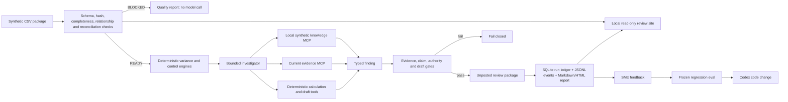

# Architecture and workflow

The demo is deliberately a small harness, not an unconstrained finance chatbot. For the data
sources and both case paths, see the [visual process design](process-design.md).



## Runtime ownership

| Concern | Owner | Why |
|---|---|---|
| Source admission | Deterministic code | Bad inputs must stop before inference |
| Financial arithmetic | Deterministic code | Exact, testable and reproducible |
| Evidence discovery | Agent with bounded tools | Flexible search is useful here |
| Current-period truth | Versioned evidence records | Historical text cannot prove current facts |
| Explanation | Agent under a typed schema | Language is useful after facts are grounded |
| Approval | Human controller | The system only creates an unposted draft |
| Improvement | Eval-led development loop | Confirmed failures become tests before changes |
| Visual review | Read-only localhost site | Browser renders curated state; Python keeps admission and finance logic |

## Live provider path

`CodexProvider` invokes `codex exec` as a subprocess. It uses the Codex desktop/CLI ChatGPT login,
the project-scoped `.codex/config.toml`, a read-only sandbox, JSONL events, and a Pydantic-generated
output schema. It does not read an API key. Replay mode uses the same `Finding` contract and all the
same downstream governance gates. The current bounded investigation procedure is embedded in
`CodexProvider._prompt`; the finance playbooks in `domain_skills/` are reference material, not yet
loaded directly by the live investigator.

## Repository map

```text
.
├── .agents/skills/          Codex build-time workflows
├── .codex/config.toml       project-scoped MCP configuration
├── controls/                canonical finance rules and evidence policy
├── data/canonical/          deterministic synthetic source package
├── demo_starter/            intentionally tiny red-test live-coding surface
├── docs/                    process design, AI development lifecycle, demo instructions
├── domain_skills/           finance SME reference playbooks
├── evals/                   frozen cases and replayed provider outputs
├── knowledge/confluence/    synthetic policy, runbook and precedent corpus
├── schemas/                 exported JSON contracts
├── scripts/                 reproducible data, index and schema builders
├── src/financial_controller/
│   ├── agent/               live Codex and replay provider adapters
│   ├── engine/              deterministic finance calculations
│   ├── evaluation/          five-case release gate
│   ├── gates/               evidence and authority enforcement
│   ├── mcp_server/          six read-only finance tools
│   ├── observability/       SQLite run ledger and raw event artifacts
│   ├── quality/             data admission checks
│   ├── reporting/           governed Markdown and HTML output
│   ├── site/                local read-only visual review
│   ├── retrieval/           stable local knowledge search
│   └── workflows/           end-to-end orchestration
└── tests/                   deterministic regression suite
```
