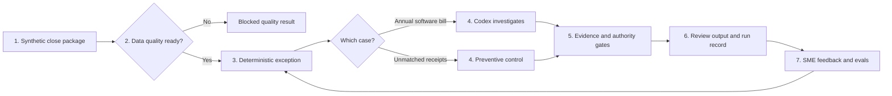
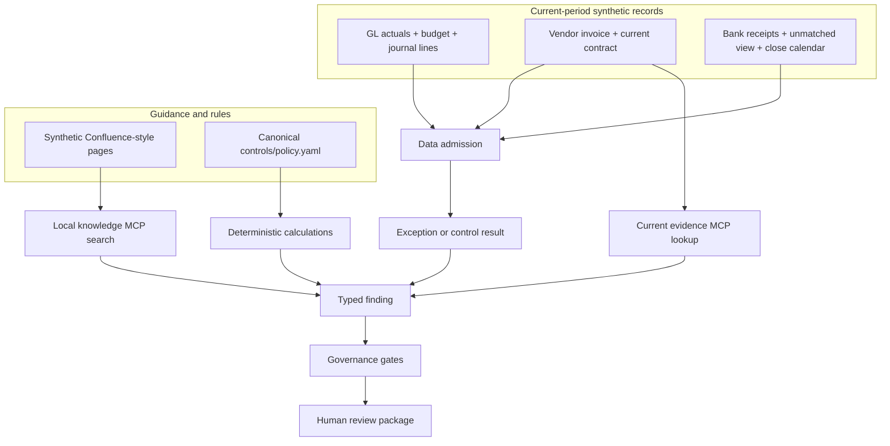
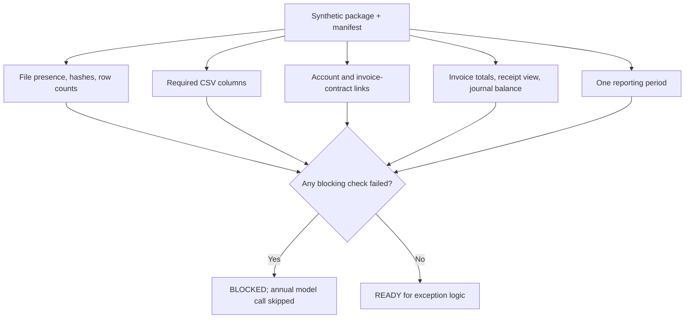
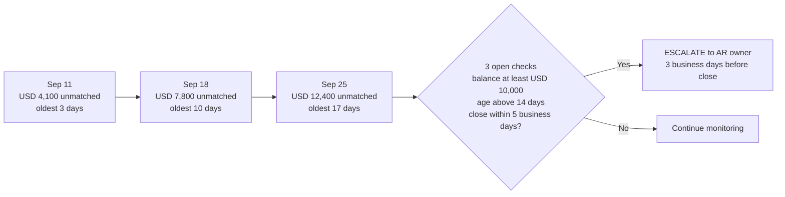

# Process design: from close data to a review decision

This page shows what happens in the running demo, where each input comes from, and what a
controller can inspect at each stage. Everything is synthetic. The diagrams are Mermaid blocks
and render directly in GitHub Markdown.

## One-screen view



The two cases share admission, policy, run storage for successful runs, and human authority. They
differ at stage 4: the annual bill needs a bounded investigation; the receipt threshold is
calculated directly. A blocked annual package creates a run record; blocked receipt admission
currently raises an error without one. The [build plan](ai-dlc/build-plan.md) calls out that gap.

## Where the information comes from



| Input | Actual location | What it can establish |
|---|---|---|
| Package identity and expected files | [`data/canonical/package_manifest.json`](../data/canonical/package_manifest.json) | Reporting period, row counts, and file hashes |
| Ledger, budget, journal, and account model | [`data/canonical/`](../data/canonical/) | The posted expense, comparison, account references, and journal balance |
| Current invoice and contract | [`vendor_invoices.csv`](../data/canonical/vendor_invoices.csv), [`contracts.csv`](../data/canonical/contracts.csv), [`evidence_manifest.json`](../data/evidence_manifest.json) | Current amount, linked contract, and service dates |
| Receipts, unmatched view, calendar, and owner | [`data/canonical/`](../data/canonical/) | Trend, age, time to close, and escalation owner |
| Prior procedures and cases | [`knowledge/confluence/`](../knowledge/confluence/) | What to investigate; never proof of this year's service period |
| Executable finance rules | [`controls/policy.yaml`](../controls/policy.yaml) | Thresholds, account mapping, and treatment convention |

No live ERP or Confluence account is connected. The local MCP server makes the synthetic knowledge
and evidence lookup visible through the same tool shape an external connector could later use.
Search is metadata-filtered lexical ranking; it is not a semantic or hybrid search service today.

## Data admission, up close



All check results are collected; this is not a step-by-step cleaning algorithm that quietly
modifies the records. `SCHEMA-*` currently means **required columns are present**, not that every
cell has passed type, null, uniqueness, or date validation. The relationship checks cover account
IDs and invoice-to-contract links; the reconciliations cover invoice/contract totals and currency,
the latest unmatched-receipt view against bank receipts, and journal debit/credit balance. The
synthetic package is deliberately narrow. [The build plan](ai-dlc/build-plan.md) includes deeper
row-level contracts as a next step, not a claim about today's validator.

## What happens at each stage

| Stage | Owner | Work performed | Artifact to inspect |
|---|---|---|---|
| 1. Load | Generator and repository | Read the September 2026 package and its manifests | `data/canonical/` and `data/evidence_manifest.json` |
| 2. Admit | `quality/validator.py` | Check files, columns, counts, hashes, account links, invoice/contract totals, receipt view, journal balance, and period | `financial-controller validate` output; `DATA-ADMISSION` gate in a run |
| 3. Detect | `engine/variance.py` or `engine/preventive.py` | Calculate the material software variance or evaluate four receipt thresholds | Variance in the agent case payload; control result in `events.jsonl` |
| 4. Investigate | `CodexProvider` and local finance MCP, for the annual case | Search guidance, fetch current evidence, call calculator and draft tool | MCP calls in `outputs/runs/<run-id>/events.jsonl` |
| 5. Check | `gates/audit.py` and workflow runner | Resolve cited IDs, inspect claims, require current proof, preserve human authority, verify draft | `gate_results` in `run.json` |
| 6. Review | Reporting and controller | Show finding, evidence map, route, and requested action; decision stays `PENDING` | `outputs/reports/<run-id>.md` or `.html` |
| 7. Improve | Run ledger, SME, and eval suite | Record time, tools, tokens, result, feedback, then freeze a failure as an eval | `outputs/run_ledger.sqlite3`, `evals/cases.yaml` |

The current HTML is a simple export. The [visualization plan](visualization-plan.md) defines the
next review board and the extra typed artifacts it needs.

## Case 1: solve the annual software bill

The problem is legible from the source records: September software expense is USD 144,000 against
a USD 12,000 budget. The USD 132,000 variance is calculated in code. The agent does not receive the
contract's service dates in its initial exception payload.

```mermaid
sequenceDiagram
    actor Reviewer
    participant Runner as Workflow runner
    participant QA as Data quality
    participant Engine as Finance code
    participant Codex as Codex investigator
    participant MCP as Local finance MCP
    participant Gates as Governance gates
    participant Ledger as Run ledger
    Reviewer->>Runner: Run annual-software-prepaid
    Runner->>QA: Validate synthetic package
    QA-->>Runner: READY
    Runner->>Engine: Calculate actual vs budget
    Engine-->>Runner: USD 132,000 material variance
    Runner->>Codex: Exception and invoice ID
    Codex->>MCP: Search close guidance
    MCP-->>Codex: Runbook and policy candidates
    Codex->>MCP: Fetch selected passage
    Codex->>MCP: Fetch current invoice and linked contract
    MCP-->>Codex: Current evidence and service dates
    Codex->>MCP: Calculate prepaid schedule
    MCP-->>Codex: USD 12,000 expense; USD 132,000 prepaid
    Codex->>MCP: Prepare unposted draft
    MCP-->>Codex: Debit 1450; credit 6250
    Codex-->>Runner: Typed finding; decision PENDING
    Runner->>Engine: Recompute schedule and draft
    Runner->>Gates: Audit evidence, claims, route, and draft
    Gates-->>Runner: Pass or fail closed
    Runner->>Ledger: Save run, events, and report
    Ledger-->>Reviewer: Review package
```

The historical page tells the agent to inspect the current contract. The invoice
`INV-SYN-1042` links to `CONTRACT-SYN-0077`, whose service dates are September 1, 2026 through
August 31, 2027. `POLICY-PREPAID-003` applies whole-month straight-line allocation. Code calculates
USD 12,000 for September and USD 132,000 for future service. The result is `RESOLVED` and routed
to `REVIEW`; the draft stays `UNPOSTED` and the human decision stays `PENDING`.

## Case 2: intervene before close

The second case shows a different pattern: a control rule notices deterioration before the final
close, without asking a model to invent a cause.



The values come from `unmatched_customer_payments.csv`, the bank-receipt reconciliation, the close
calendar, and `POLICY-AR-007`. The rule is conjunctive: all four conditions must hold. The result
is `UNRESOLVED` with route `ESCALATE`, because the data shows a worsening control but does not prove
why individual receipts remain unmatched.

## Where the workflow stops

| Situation | System outcome | Reason |
|---|---|---|
| Required source data fails admission | Block the annual investigation before the model call; receipt case currently exits with an error | Garbage should not become a confident finding |
| Current contract is missing | `PARTIAL` and `ESCALATE` in the frozen eval case | Prior-year precedent cannot prove this year's service period |
| Current invoice, contract, calculation, and draft agree | `RESOLVED` and `REVIEW` | The controller still owns approval |
| Unmatched receipts cross the preventive thresholds | `UNRESOLVED` and `ESCALATE` | Intervention is needed before a root cause is established |

The missing-contract case is currently a replay fixture, not a full altered-package live run. That
is a specific next eval improvement in the [build plan](ai-dlc/build-plan.md).
