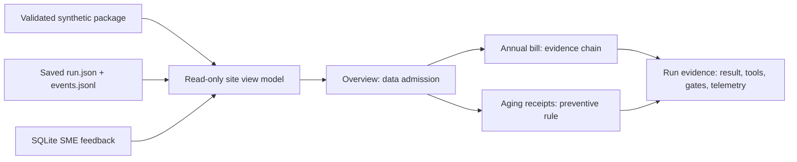

# Visual review experience

The [process design](process-design.md) is the GitHub-readable map. The local review site turns
the same synthetic close into a walkthrough inside Codex desktop. Start it with `make site`, then
open [http://127.0.0.1:4173/](http://127.0.0.1:4173/). It does not need an API key or a hosted
service.

## What is implemented

| View | What a reviewer can inspect | Truth boundary |
|---|---|---|
| Overview | The full admission checklist, grouped status, and two case entry points | A blocked package hides derived case outputs |
| Annual bill | Variance, historical guidance, current invoice and contract, prepaid calculation, unposted draft | The five-step path is a **source-derived preview**; a saved run's finding is labeled separately |
| Aging receipts | Three weekly snapshots, amounts, item age, four rule thresholds, and escalation owner | The control is deterministic; no root cause or entry is invented |
| Run evidence | Saved live/replay result, time, tokens, reported cost, selected tool calls and IDs, gates, SME feedback | Only recorded tool completions are shown; no private reasoning is reconstructed |

The browser only renders curated JSON. Python validates the source package, performs the finance
calculations, and reads saved artifacts. The server serves only its static files and `/api/state`,
binds to `127.0.0.1`, and has no route to start an agent, record feedback, approve, or post.

Historical guidance is visibly distinct from current support. Every view carries a synthetic-data
label. Drafts remain `UNPOSTED`, and the human decision remains `PENDING`. When Codex subscription
usage provides tokens but no dollar cost, the site says “not reported” rather than estimating it.

## Next provenance pass

This is an effective presentation view, not a complete run-reconstruction bundle. The current
source-preview panels recompute from the validated current package; they are not frozen copies of
each past run. `run.json`, JSONL events, and the ledger are saved, but a standalone `quality.json`,
exact selected search hits, calculation, and draft lines are not persisted together per run. The
trace also does not currently capture per-tool duration.

Before treating the site as an audit view across changing packages, persist typed stage artifacts
with package and policy versions. Then link each monetary claim to the exact source record,
content hash, calculation, and gate that supported that run. A blocked receipt case should also
save a run record, as the annual case already does. Freeze regression tests for those contracts
before changing the UI.

## Acceptance and demo use

Open a successful live annual run, a replay run, the receipt escalation, and a blocked-data
fixture. A reviewer should be able to answer: What happened? Which current records support it?
What did code calculate? Which gate allowed or stopped it? What must a human do next? The local
site covers the presentation path today; the provenance pass above makes it durable across
future data versions. No visual component may change a `Finding`, `DraftAdjustment`, or route.

Hosting a separate presentation Site is optional and is not needed for the Codex demo.
